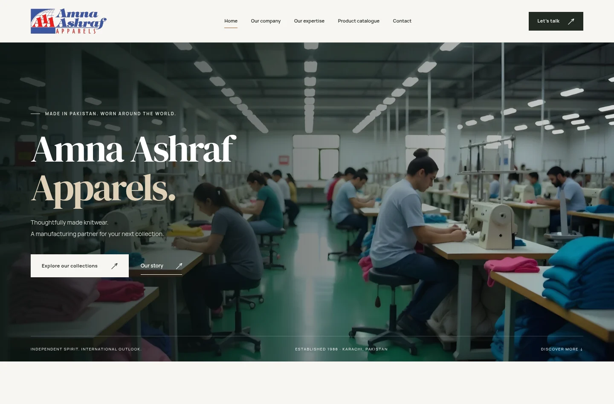

# Amna Ashraf Apparels

A complete static presentation redesign of [aaapparels.com](https://www.aaapparels.com/),
with the original logo, company information and product photography.

**[Open the presentation](https://waqasmir89.github.io/AAApparels/)** ·
[Original page coverage](docs/PAGE_MAP.md) · [Build plan](BUILD_PLAN.md)



## What is included

- All **11 distinct original pages**, plus service and catalogue overviews, a
  printable product catalogue, and a helpful 404 page: **15 pages** in total.
- Men’s wear, ladies’ wear, and kids/teen catalogues, each preserving the 12
  product entries and photographs shown in the corresponding original catalogue.
- The original logo unchanged, web-sized original photography, and self-hosted
  Manrope and DM Serif Display fonts.
- Responsive layouts, accessible mobile navigation, keyboard controls, product
  filtering/search, image enlargement, native FAQs, and reduced-motion support.
- Contact details, telephone/WhatsApp links, and an enquiry draft composer.
- A print-friendly catalogue with a browser Print / Save as PDF action.

This is a static website proposal for client review. Pages are marked `noindex`.
Enquiries prepare an email draft for the visitor to send. All hosting output is
ordinary HTML, CSS, JavaScript, images and fonts; GitHub Pages needs no application
server, PHP, database or runtime services.

## Run locally

Requires Node.js 22 or newer. The static build itself uses only Node's standard
library; dependency installation is needed for browser verification.

```sh
npm run build
npm start
```

Open **http://127.0.0.1:4173**. The output in `dist/` can be served by any ordinary
static host. Primary navigation and product content work without JavaScript.
Rebuild after source changes.

## Verify

```sh
npm ci
npm run build
npm run check
npx playwright install chromium
npm test
```

Checks cover local links/assets, all original pages, catalogue completeness and
the original logo hash. Browser verification covers 34 page/viewport checks,
11 automated accessibility audits, catalogue interactions, mobile keyboard
navigation, navigation without JavaScript, draft composition and PDF rendering.

Screenshots, a PDF review copy and structured results are written to
`output/playwright/` and excluded from Git. Automated accessibility checks are
useful evidence alongside visual and assistive-technology review.

## Edit and extend

| Path | Responsibility |
| --- | --- |
| `content/site.mjs` | Company details, services, collections, products and FAQs |
| `content/assets.json` | Original asset URLs, hashes, dimensions and local paths |
| `scripts/build.mjs` | Shared layouts and static page generation |
| `src/styles/site.css` | Typography, palette, responsive layouts, motion and print styles |
| `src/scripts/site.js` | Progressive browser interactions |
| `public/assets/` | Local images, fonts and font licenses |
| `docs/PAGE_MAP.md` | Source coverage and original-site corrections |

Backend enquiries, catalogue administration, analytics, authentication and other
business workflows belong to a separately agreed implementation phase. Content
and layout boundaries support that transition.

## GitHub Pages

The **Verify and publish presentation** workflow builds and checks the site,
runs Chromium and accessibility checks, saves review artifacts, and deploys the
passing `dist/` artifact to GitHub Pages. A failed verification job prevents
publication. GitHub Pages is configured to use **GitHub Actions** as its source.

Push source changes to `main` to update the presentation. To roll back, revert the
relevant source commit and let the workflow verify and redeploy it.

## Source and asset rights

The original public website was inventoried on 24 October 2026. See the page map
for source inconsistencies corrected or excluded from the presentation. The
print layout is a new arrangement of the original product range; no PDF was
linked from the original public pages.

The manual **Capture original website** workflow retains an inventory artifact
for review and never submits forms. To recapture locally with Python 3.10+:

```sh
python3 scripts/inventory_source.py
# Optional asset preparation requires Pillow:
python3 scripts/prepare_assets.py source-audit
```

For local asset preparation, place the four licensed font files in
`source-audit/fonts/`, as the capture workflow does. Captures and research archives
are ignored by Git. Inspect failed URLs and review navigation before claiming
completeness after a future recapture.

Original company photographs and brand marks retain their owners' rights. No
open-source license is applied to those assets. Font licenses are included in
`public/assets/fonts/`.
